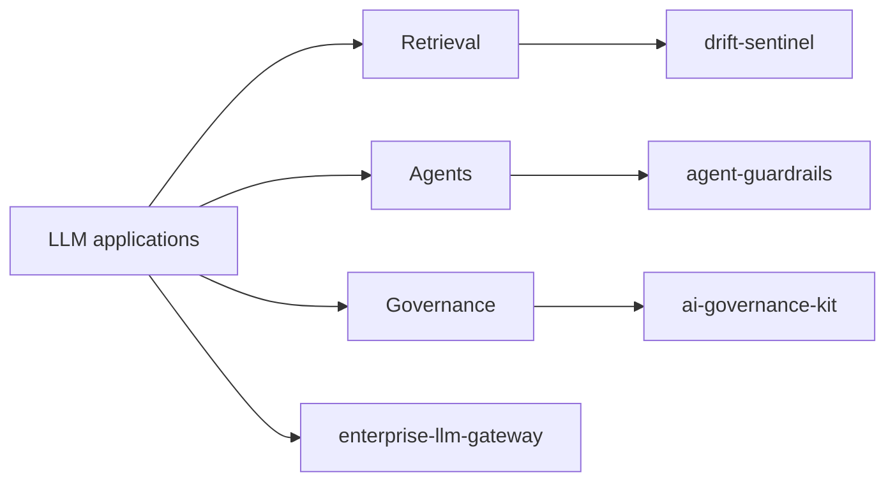

# Sajjad Rabby

**AI Systems Architect · Project & Operations Lead**

I build production Python systems for the parts of AI that break under real
load: model governance, drift monitoring, agent safety, and retrieval. I care
about software that a colleague can run at 2am without a phone call - which
usually means **zero mandatory dependencies** and **tests that run offline**.

---

## Selected work

Five complete, MIT-licensed Python libraries. Every one is stdlib-only at
runtime, fully type-hinted, documented, and ships with an offline test suite.

| Project | What it does | Tests |
|---|---|---|
| **[enterprise-llm-gateway](https://github.com/sajjad-rabby/enterprise-llm-gateway)** | One OpenAI-compatible API in front of many model providers, with response caching, strategy-driven routing, automatic failover, and an auditable spend ledger. | **145** passing |
| **[ai-governance-kit](https://github.com/sajjad-rabby/ai-governance-kit)** | AI governance workflow in one CLI: model cards, risk registers, EU AI Act classification, 21 CFR Part 11 / ALCOA+ checklists, and a hash-chained audit log. | **180** passing |
| **[drift-sentinel](https://github.com/sajjad-rabby/drift-sentinel)** | Production drift and LLM monitoring: PSI / KS / JS distance statistics, threshold alerting, Prometheus metrics export, and JSON + Markdown reports. | **178** passing |
| **[agent-guardrails](https://github.com/sajjad-rabby/agent-guardrails)** | Safety layer for tool-calling LLM agents: policy rules, human-in-the-loop approvals, tool/spend/time budgets, and a tamper-evident audit log. | **179** passing |
| **[rag-foundry](https://github.com/sajjad-rabby/rag-foundry)** | Modular retrieval-augmented generation pipeline: chunking, embedding, indexing, retrieval, grounded generation, and retrieval evaluation. | **101** passing |

**783 tests passing. Zero skipped. Zero runtime dependencies.**

Also: **[vet-checkin](https://github.com/sajjad-rabby/vet-checkin)** - a
multi-tenant veterinary clinic app on Next.js 15 / React 19 / TypeScript with
a typed Supabase data layer.

---

## What I build

- **Reliability** - caching, retries, failover, timeouts, and budgets that
  actually stop runaway spend.
- **Observability** - drift metrics, Prometheus endpoints, and audit trails
  that are tamper-evident rather than merely present.
- **Compliance** - EU AI Act risk triage, NIST AI RMF risk registers, and
  21 CFR Part 11 style audit chains.
- **Security** - allow/deny policy, human approval for sensitive actions, and
  schema validation on every tool call.

---

## Engineering principles

**No mandatory dependencies.** Standard library only at runtime. A Python tool
that needs `pip install` before it can say hello is a tool that fails on the
machines where you need it most.

**Offline by default.** The whole test suite runs with no network and no
credentials. That makes it fast, deterministic, and safe in a locked-down
environment.

**Typed and documented.** Every public function carries type hints and a
docstring. `pyproject.toml`, MIT licence, and a README with a real architecture
diagram come with every project, not as an afterthought.

**Explain the numbers.** Monitoring tools are only useful if a human can read
the output and know what to do next. Reports are Markdown first, JSON second.

**Fail loudly, fail usefully.** Errors carry the context needed to act on them,
and the audit log records what was attempted - not just what succeeded.

---

## Current focus

- AI systems architecture and operational reliability for production LLM workloads
- Project and operations leadership
- Building evaluation and governance into AI delivery pipelines early, not at audit time

---

## Contact

- GitHub: [@sajjad-rabby](https://github.com/sajjad-rabby)
- Personal site: [symcora.com](https://symcora.com/)
- Location: Bangladesh

*Every project above is MIT licensed and maintained by me - pull requests and
issues are welcome.*
